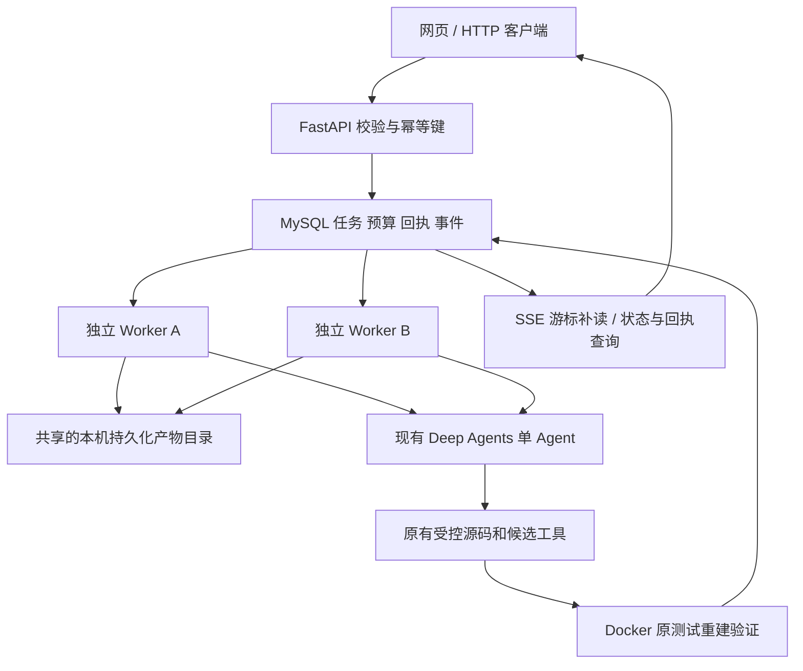

# MySQL 持久任务与独立 Worker

本批保留单 Agent、原编辑/语法/隔离/独立验证，不调整修复算法。不调用真实模型。新能力通过 `serve --backend mysql` 和 `worker` 显式启用；不自动迁移旧 SQLite，不推送远端。

## 架构和数据流



API 不启动后台线程、没有执行器文件锁，也不加载模型凭据。多个 Worker 通过数据库领取；每个 Worker 顺序执行一个任务，多个 Worker 可处理不同任务。本批只支持同一台机器上、相同批准仓库范围和同一共享产物根目录的进程，不宣称跨主机分布式部署。HTTP 仍仅监听 127.0.0.1，没有公网或多用户鉴权。

流程：请求内容规范化及摘要 → 唯一幂等键裁决 → 固定 Git SHA → MySQL queued → 短事务领取及 generation 增加 → 心跳续租 → 快照与原始失败阶段确认 → 持久化模型调用预留/发起 → Agent 受控工具 → 持久化候选预算 → 原子编辑/语法/去重 → 持久化可恢复候选 → 原基线独立重建 Docker 验证 → 验证回执 → 终态事务与事件 → 人工查看和下载补丁。

## 数据表与权威边界

SQL 位于 `repair_workbench/migrations/001_mysql.sql`，全部使用 InnoDB。

| 表 | 关键内容及约束 |
| --- | --- |
| backend_schema | 追加式初始化的版本记录；当前版本 1 |
| repair_tasks | 请求 JSON、内容摘要、唯一幂等键、状态/阶段、owner、generation、lease_until、累计预留预算与 agent_deadline |
| task_attempts | 主键 (task_id,generation)，记录每代 Worker、心跳和终态 |
| model_calls | 主键 (task_id,number)，调用预留、发起、完成、未知及用量；number 跨代递增 |
| repair_candidates | 主键 (task_id,number)，候选预留、可恢复、已验证/拒绝，关联路径和 Hash |
| stage_artifacts | 每代 snapshot/baseline 阶段确认，路径、内容身份、报告摘要 |
| test_runs | 每次已保存验证的镜像/结果、报告路径与 Hash；包含原始基线与候选验证 |
| task_events | 自增事件序号，索引 (task_id,sequence)，支撑 SSE 游标与查询 |
| execution_resources | 每任务唯一随机容器名及所属代次，用于取消和崩溃接管清理 |

模型消息全文、源码、XML、日志和 patch 不塞入数据库；保存在 generation 独立目录。数据库中的结果是汇总和引用。大文件发布与数据库事务不是一个原子事务：采用“先写新目录、完成并校验、后提交确认”。崩溃可能留下未登记文件，但不会将半份文件当成已确认结果，也不会覆盖历史目录。本批不做磁盘垃圾回收。

快照校验同时使用原有 verify_snapshot、完整清单与补丁摘要；测试报告另做目录摘要。生成报告不会改变已确认快照的内容身份。恢复遇到篡改、缺失或符号链接会拒绝，不重新信任自报 Hash。

## 事务、租约与 CAS

- 每次连接使用 UTC、READ COMMITTED；每个事务结束立即关闭连接，没有数据库连接跨模型调用或 Docker 测试持锁。
- 领取使用 `SELECT ... FOR UPDATE SKIP LOCKED`，只选 queued 或租约到期的活动任务。在同一事务增加 generation、设置 owner/lease、建立 attempt，并把旧 started 模型回执转 unknown、旧 reserved 转 abandoned。
- 续约只接受仍有效且 owner/generation 匹配的任务，不允许过期拥有者通过 heartbeat 自行复活。
- 关键写入先锁定任务行，再比较 owner、generation、lease 和允许状态；检查与写入处于同一短事务。这是锁保护下的 compare-and-set，不是无锁算法。并发接管无法越过该事务修改代次。
- 任务推进、事件、模型回执、预算、阶段、候选、测试结果、资源与终态都经过该 guard。取消是用户侧命令，与 Worker 写入分开。
- 心跳默认每 lease/3 续约；默认 lease 15 秒。测试使用 3 秒，以真实进程 SIGSTOP 自然过期验证接管。数据库故障/续租失败使本地执行失去准入，后续受控操作停止；可预留预算不因此返还。

CAS 防止陈旧结果成为权威记录，不代表外部模型调用或 Docker 在网络分区/进程暂停下恰好执行一次。在每个外部操作之前检查所有权并持久化准入，在等待中检查取消/租约，所有产物按代次隔离。已经发给供应商的请求可能继续处理，不能保证取消或退款。

## 请求幂等

MySQL HTTP 创建任务要求 `Idempotency-Key`（1–128 字符 ASCII 键）。相同键/相同规范请求返回原任务，相同键/不同内容返回 HTTP 409。并发首次创建由唯一索引裁决。新建任务使用新键，而不是按任务内容永久去重。

请求摘要在解析 HEAD 前计算，首次创建的任务另存解析后的 SHA。因此 HEAD 前进后，同一个键的重试仍返回最初任务；新键才创建新提交任务。批准文件排序去重，profile 与预算都属于请求身份。

浏览器对同一未成功确认的提交保留幂等键，内容变化或成功后创建新键。这不是跨浏览器刷新持久化重试；HTTP 调用方需要自己保存键。

## 持久化预算与模型回执

`calls_reserved` 与 `candidates_reserved` 在任务行累积，不随代次重置。新 Session 使用已有预留数作为起点。数据库预留事务内还检查永久 agent_deadline，不能依赖调用方检查来绕过截止。

调用状态：

1. reserved：额度已持久化，但尚未准入实际请求。
2. started：准入发起已持久化，接下来调用模型。该状态与真正网络发送之间仍有不可避免的窗口，崩溃时保守处理。
3. completed：已保存合法 input/output 用量回执。
4. unknown：发起后无回执，或响应缺少完整用量；不记零 token、不自动重试，任务中断。
5. abandoned：接管时只有预留、尚未准入调用；保留占用，可继续使用剩余额度，不退款或补足上限。

完整响应已返回但尚未生成可恢复候选时，本批不重放模型上下文，终止为 agent_context_not_resumable。不会重新赋予一整套调用预算。

候选预留在实际构建前持久化；版本/权限/唯一性/语法拒绝也占额度，与原 Session 规则一致。独立评测器和历史成绩不改口径。新持久队列没有自动批量评测入口，不应用新故障测试分数替代模型修复成功率。

## 恢复策略

| 已确认阶段 | 新 Worker 行为 |
| --- | --- |
| 仅 snapshot | 校验并复制到本代目录；不复用未确认报告，重新执行基线 |
| baseline | 校验快照及报告 Hash，复用原始失败和实际镜像身份 |
| candidate ready | 校验同一候选；在新代独立 verification 目录运行原测试，不重新调用模型 |
| candidate verified | 校验已验证源码、patch、报告 Hash；通过结果可完成交付，不重复测试 |
| started/unknown 模型调用 | 保留预算、未知用量；停止，不重发 |
| 有历史模型响应但无可恢复候选 | 停止，原因 agent_context_not_resumable |
| 已存在候选但无通过结果 | 本批不重建完整 Agent 上下文来继续推理，明确中断 |

每代产物位于 `runs/<task_id>/generation-NNNNNN/`。恢复验证位于新代 `recovery-NN/`，旧候选保持原字节。source_ref 不跨 Session 重放；本批复用的只是已物化候选和验证记录。

Docker 在启动前将随机容器名登记，取消时终止 docker 客户端并强制清理。新 Worker 先清理旧代已登记容器，不对其他项目容器执行清理。

模型请求进程新增随机 request_process_id，记录在受控事件与进程命令标记中，不含密钥。父 Worker 被 SIGKILL 后，新 Worker 使用 PID、随机标记及进程组身份确认旧请求子进程，才能终止它；不盲目根据旧 PID 杀进程。身份或清理无法确认就停止。它只控制本地进程，不证明远端停止推理。POSIX/macOS 实测；跨主机和 Windows 不在范围。

## 本机启动

新数据库环境需要事先安装/镜像下载授权；本轮已授权并实际准备 MySQL 8.4.11、PyMySQL 1.2.3。驱动安装在项目 .venv；已有 cryptography 由 Agent 锁文件提供。没有全局安装。

```bash
# 干净环境：先安装原工作台依赖，再安装 backend 附加依赖。
.venv/bin/python -m pip install -r requirements-agent.lock -r requirements-backend.lock
.venv/bin/python scripts/prepare_mysql.py
# 仅首次、尚无同名容器时使用；当前开发机容器已启动，无需重复创建。
docker compose -f compose.mysql.yml up -d
.venv/bin/python -m repair_workbench init-db --db-env runtime/mysql-backend/client.env
```

私有配置只生成在忽略 Git 的 runtime/mysql-backend，0600 权限，不打印密码。首次初始化同时建立独立 repair_workbench_test 库供验收。配置脚本拒绝覆盖已有凭据；删除数据卷会丢数据库，本文不提供自动 reset/down -v 操作。

若使用已创建的本机容器，停止后可用 `docker start repair-workbench-mysql`；这是本批专用容器，与其他项目数据库分离。

```bash
# API 进程：只接收任务和查询，不加载模型凭据。
.venv/bin/python -m repair_workbench serve --backend mysql \
  --db-env runtime/mysql-backend/client.env \
  --data-dir /absolute/path/to/repair-task-data \
  --repo-root /absolute/path/to/approved-repositories \
  --image repair-workbench-test:20261014-pinned --profile v2

# 在不同终端启动独立 Worker，可重复启动多个。
# 不指定 --env-file 时不会创建付费模型客户端，已有候选仍能恢复验证。
.venv/bin/python -m repair_workbench worker \
  --db-env runtime/mysql-backend/client.env \
  --data-dir /absolute/path/to/repair-task-data \
  --repo-root /absolute/path/to/approved-repositories \
  --image repair-workbench-test:20261014-pinned --lease 15
```

真实推理须 Worker 显式传 `--env-file /private/model.env`，会产生费用，本批禁止、未执行。生产 CLI 不提供测试模型模式；Fake Model 只在测试文件中注入。`--once` 用于处理一次可领取任务。所有进程必须配置相同 data-dir、仓库范围和适合目标项目的本地镜像。

数据库初始化需要预先创建库/用户权限；应用运行用户不应拥有跨项目数据库权限。本地专用用户仅能操作本批开发/验收库。备份必须包含数据库与共享产物目录，在停止 Worker 后取得一致备份。

## 兼容与回退

- 原 snapshot/test/candidate/verify/repair CLI 保留；纯逻辑无需导入 MySQL 驱动。
- `serve` 不传 backend 仍默认 sqlite，兼容历史启动方式；新可靠后端明确用 `--backend mysql`。保留兼容默认不意味着 MySQL 是自动切换后的旧入口。
- 两后端不共享/双写任务。旧任务继续用旧 SQLite 服务及原 data-dir 查询；新 MySQL 使用新 data-dir。不要把 SQLite 的活动任务直接复制成 queued。
- 暂不提供 SQLite 全量导入工具。迁移策略为保留旧记录只读/兼容查询、新任务进入新后端；回退时停止新 Worker，使用旧入口和独立旧数据。不能将 MySQL 活动任务反向写回 SQLite。
- 历史标签和评测数据不变；新增 durability/control 参数为可选，旧执行链不承担新预算或恢复策略。

## 验收与限制

真实验收测试位于 `tests/test_mysql_backend.py`，进程模型在 `tests/backend_worker_probe.py`。使用真实 MySQL、spawn 独立进程、SIGSTOP/SIGCONT、SIGKILL、同步文件屏障、真实 Docker 与 HTTP 服务重启。测试数据库与开发数据库分开，失败证据不覆盖，不手改 lease_owner 模拟接管。用量为测试替身明确提供的合成数字，不是模型实测。

```bash
RUN_MYSQL_TESTS=1 RUN_DOCKER_TESTS=1 \
REPAIR_MYSQL_TEST_ENV=runtime/mysql-backend/client.env \
REPAIR_TEST_IMAGE=repair-workbench-test:20261014-pinned \
.venv/bin/python -m unittest discover -s tests -v
```

不启用 MySQL 标志时专项测试会明确跳过，不能称为完整验收。具体本轮结果、版本及证据见 backend-acceptance-20261020.json。

限制：没有自动 LangGraph 续跑、分布式 exactly-once、数据库故障转移、跨主机产物存储、请求进程跨主机终止、磁盘配额/清理、全局模型并发限额、连接池或吞吐基准。未验证真实模型或新的修复成功率。失去 Worker 后需要至少租约到期才能接管。未确认的 Docker 操作只允许在清理后新代有界重验；测试运行历史与容器准入记录分开，不能据 test_runs 行数推算所有已发起容器数。

第二批仅建议在真实瓶颈证据下考虑 Redis 的 AST 缓存及事件唤醒；数据库事件仍是权威，Pub/Sub 丢失不能丢业务事件。并发性能需区分 HTTP、排队与修复时长，单独测 1/2/4 Worker 和内存上限。当前不实施或自动启动第二批。
