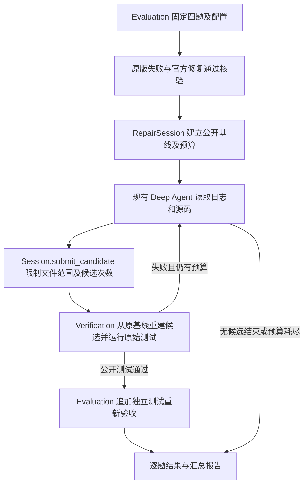

# qwen-plus 基础 Agent 评测记录

日期：2026-10-11。批次：`runtime/eval-baseline-qwen-plus-20261011/`。

## 结论

4 个真实历史 Bug 任务均完成评测，0 个成功修复。公开测试通过 0 题，独立验收实际执行 0 题；不能表述为“4 题都在独立验收中失败”。2 题没有产生候选，另 2 题共提交 4 个候选，全部在测试收集阶段因生成代码语法/缩进错误失败。

这是一份基础能力负结果。没有修改测试、人工修补候选、追加预算或重跑以替换失败记录。4 题来自同一上游项目的完整模块切片，不能用 0/4 推断所有真实仓库的成功率。

## 冻结配置

- 模型：DashScope `qwen-plus`；使用既有 ModelSettings 配置，未更换模型。
- Prompt、工具、Session、Verification 与评测器源码：运行前指纹与运行后逐文件核验一致。
- 每题最多 12 次模型调用、3 个候选、240 秒软截止，每次 Docker 测试 30 秒；四题最多 48 次调用。实际 37 次。
- 输出配置仍为 `max_tokens=4096`，`max_retries=0`；temperature/thinking 仍使用既有供应商默认值。
- 数据集 SHA-256：`469fb897059715fc53a849459c9c1366cf4a038acba720a28ad95e9802de33fc`。
- Docker：`sha256:6beb75435772a990eda22f9b97c44d529121c8652e899d5419f2ca6b47e7e302`。
- 使用模型别名，未记录供应商实际后端版本；不保证未来请求逐字复现。

## 逐题结果

| 任务 / Bug | 模型调用 | 候选 | 输入 token | 输出 token | 评测耗时 | 结果 |
| --- | ---: | ---: | ---: | ---: | ---: | --- |
| Bits 负索引未按序列规则归一化 | 12 | 2 | 96,384 | 6,810 | 166.589 秒 | 两次相同候选，IndentationError，调用预算耗尽 |
| 空 Bits 转换未保持空值 | 6 | 0 | 29,080 | 4,822 | 111.434 秒 | 仅输出分析，未提交候选 |
| namedtuple/namedlist 空名称错误类型不符 | 7 | 0 | 40,606 | 1,974 | 49.647 秒 | 定位问题但未提交候选 |
| JSONLIterator 拒绝 rel_seek=1.0 | 12 | 2 | 120,369 | 8,477 | 200.526 秒 | 行号混入源码，SyntaxError，调用预算耗尽 |
| 合计 | **37** | **4** | **286,439** | **22,083** | **528.196 秒** | **0/4 成功** |

耗时为评测器各题连续执行时长之和，包含任务准备、官方修复资格核验、Agent 和容器测试，约 8 分 48 秒；Agent 会话事件时长合计 514.596 秒。计时不包括后续报告整理和回归测试。

37 次调用均有供应商返回的用量报告，总计 308,522 token。实际支付金额未读取供应商账单，不能将 token 报告当作账单。业务工具共调用 35 次，框架规划工具不计入该数。

### 1. bits-negative-index

业务要求：负索引应访问对应元素，过大负索引及空序列访问应抛出 IndexError。

Agent 读取日志及源码，诊断指出需要用 `k + self.len` 归一化负索引，候选中也包含这一逻辑。但它在整个模块顶层多写了一层空格，导致第 31 行 `IndentationError: unexpected indent`，公开测试尚未执行即收集失败。

第二次候选与第一次内容标识完全相同：`442bb4718a78ad55c2889b43c66b406d9e829cf2d1171ce76f82a976f9aaceac`。错误反馈后没有形成有效修订，最终在第 12 次模型调用后触发预算限制。

证据：该题 `agent/result.json`、`events.jsonl`、两次 `attempt-*/verification/reports/pytest.log` 和 `patch.diff`。修复意图有依据，不代表已经得到可执行或语义正确的修复。

### 2. bits-empty-conversion

业务要求：空 Bits 的二进制、十六进制、字节表示及往返转换保持空值，非空转换不能回归。

Agent 读取了相关源码，最后输出一段较长分析，并以“让我写一个候选修复”结束，没有调用 submit_candidate。期间对构造函数和格式化规则的解释有反复，不能将最终叙述当成经过执行验证的事实。

会话以 `agent_finished` 结束，但应用结果为 `inconclusive/no_candidate`，仅用了 6/12 次调用。现有记录不包含逐次 finish_reason、invalid_tool_calls 和逐次 token 明细，因此不能确认是输出截断、工具调用解析问题还是模型自行结束；不据此直接认定必须增加 max_tokens。

### 3. named-empty-name

业务要求：空类型名或空字段名应抛出 ValueError；保留 rename=True 的自动重命名。

Agent 在最终文字中准确指出两种工厂访问 `name[0]` 前缺少空值校验，并提及 rename 分支。但在“Let me create the fix”后结束，没有产生候选或运行修复后测试。

结果同样为 `inconclusive/no_candidate`，7/12 次调用。诊断文字与问题吻合，执行链没有完成。不能用文字中的正确方案替代成功补丁。

### 4. jsonl-end-seek

业务要求：接受右边界 rel_seek=1.0，保持非法左边界 -1.0 被拒绝。

首个候选把 `read_source` 的 `1: ...` 行号前缀直接写入真实 Python 文件。两次候选均报 SyntaxError，日志在第 216 行提示三引号字符串未终止。第二次虽改变了文件内容，仍保留行号污染，未通过测试收集，最终耗尽 12 次调用。

候选还将区间改为 `-1.0 <= rel_seek <= 1.0`，超出任务所需的右端点修复，静态审查可见它同时放宽了左端点。这是潜在语义回归；由于语法错误阻止执行，本轮没有对这项回归进行动态确认，也没有在修正语法后私自追加评测。

## 评分与诊断边界

原始结果 `outcomes` 为 `model_call_limit: 2`、`agent_finished: 2`，表示控制流停止原因，不是业务修复原因。本报告结合 `agent.reason` 和候选日志归类为：无候选 2 题、候选语法/缩进失败 2 题。原始 JSON 未被改写。

原始汇总 `patch_lines=0` 只累计公开验证通过后的补丁，不表示没有产生修改。4 个失败候选的 diff 均已保留。目前尚不能从报告断言任何题的隐藏语义测试结果。

## 业务调用链与模块协作



Evaluation 负责选题、固定环境、隔离独立用例及统一评分；不代替 Agent 诊断。Session 负责允许修改范围、调用与候选预算、事件和会话结果。Verification 仍负责重建原始测试、检查回归并决定候选是否通过。评测器只有在公开测试通过后才进行独立验收。本轮该分支没有被真实模型触发，已有确定性集成测试验证其正确候选通过与过拟合候选拒绝行为。

## 下一阶段优先级

第一优先级是**候选提交与错误恢复的可靠性**。两题产生的 4 个候选全部因表示/格式错误无法执行，另两题止于文字分析。当前数据不足以证明检索、知识量或多 Agent 协作是主要瓶颈。

建议分开验证以下通用改进，避免一次改变多个因素：

1. 先补必要观测：记录 finish_reason、非法工具调用、逐次用量和可脱敏的工具参数摘要，明确“无候选结束”的原因。保持 no_candidate 为未成功结果。
2. 以源文件哈希和唯一匹配为前提，支持局部修改，由应用保留未修改内容；加入语法检查和重复候选识别，降低整文件重写、行号复制及无效重试的风险。语法检查不能代替实际测试。
3. 在知道停止原因后再决定是否加入有界的“未提交候选”恢复流程，共享原调用预算，不能无上限催促或仅靠提示词宣布成功。

以上是待验证的优化方案，本轮没有实现。下一轮比较时保持四题、模型和预算相同，逐项归因；同时需要新的未用于调优的任务验证泛化。不能对这些具体答案硬编码。

## 自动化验证与复查

- 完整回归：70 项通过，0 跳过，25.042 秒；`runtime/eval-baseline-regression-20261011.log`。
- 依赖检查：pip check 通过。
- 证据审计：24 份快照哈希、数据集及运行源码不变、四题范围和预算、事件与调用计数、报告重算、受保护文件、同一镜像与容器清理均通过。
- 在临时副本中分别篡改汇总计数、重复题号、提高预算、改动候选文件，4 项负向检查全部被拒绝；未改动原始运行证据。

复查命令（不调用模型，也不执行候选代码）：

```bash
.venv/bin/python scripts/audit_baseline_evidence.py runtime/eval-baseline-qwen-plus-20261011
```

审计将当前运行代码与该批指纹比较，未来有意修改 Agent 后可能报告代码已变，这不是旧评测结果被推翻。原始结果、事件、候选和日志继续作为本轮基线证据保留。
