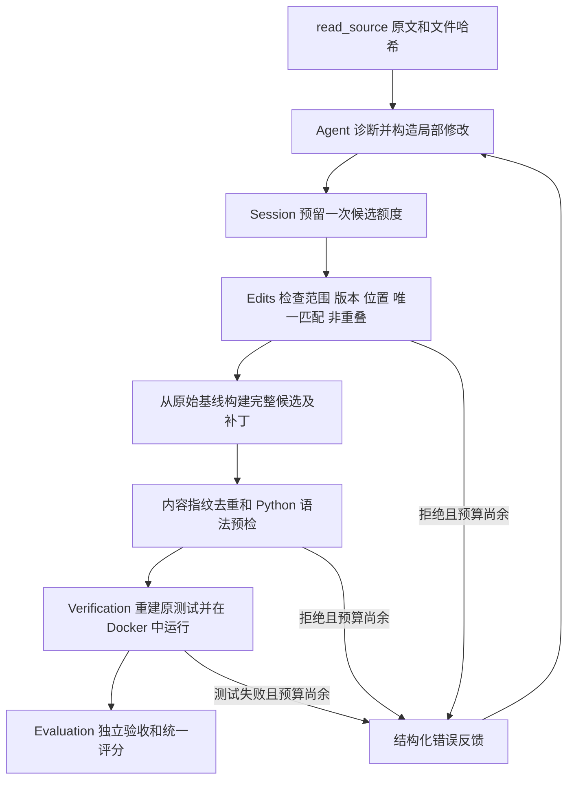

# Agent 修复可靠性 v2

## 目标与范围

针对四题基线中出现的整文件缩进污染、行号混入源码、重复无效候选和无候选结束，改进候选提交边界及运行观测。保留单 Agent、原模型配置、调用/候选预算及独立验证规则。不加入自动续问，不增加 max_tokens，不更改原四题测试。

## 修复业务流程

优化前：固定提交 → 公开测试复现 → Agent 读取带行号源码 → 整文件替换 → Docker 原始测试 → 公开通过后独立验收 → 结果统计。

优化后：固定提交 → 公开测试复现 → Agent 读取原文与文件版本 → 局部编辑/兼容整文件提交 → 范围和编辑锚点检查 → 重复识别 → 语法预检 → Docker 原始测试 → 公开通过后独立验收 → 结果统计。

Session 继续拥有权限和资源预算；Agent 只能提出修改。Edits 不执行代码、不改变原始基线。Verification 的测试身份、回归检查和 Docker 规则未更改。Evaluation 的题集选择、资格核验、隐藏用例隔离、评分分母未更改。

## 工具和模块

### read_source

默认仍返回带行号的 `content`，保持兼容。新增 `raw=True`，返回保留原缩进及换行的无行号原文。两种模式都返回 `sha256`、`start_line`、`content_format` 和 `truncated`。每次只返回一种表示，避免重复传输整段源码。

模型构造局部修改时使用 raw 模式。文件版本哈希来自完整原始文件，不是截取片段；读取和编辑前均核验快照。截断片段不应作为完整替换文件。

### submit_edits

新增业务工具，参数为 edits 列表和 diagnosis。每项必须且只能包含：

| 字段 | 约束 |
| --- | --- |
| path | 已在应用批准范围内、已存在的 Python 源文件；测试与配置禁止修改 |
| sha256 | 与原基线完整文件哈希一致 |
| start_line | 匹配文本起始行，正整数 |
| old_text | 非空、逐字匹配且在完整文件中只出现一次 |
| new_text | 替换文本，允许空字符串表示删除匹配片段 |

每批最多 32 项，每段旧/新文本最多 64 KiB，最终文件最多 1 MiB。所有编辑相对同一原始基线定位，按位置逆序应用；检查重叠，包括跨行重叠。匹配不唯一时应扩大上下文，不做模糊猜测。整批检查完成后才输出候选内容，失败不会产生部分修改。后续候选仍从原基线派生，必须包含需要保留的全部改动，不隐式叠加上次候选。

`edits.py` 实现匹配和语法检查。`session.py` 的 submit_edits 与旧 submit_candidate 共用 `_submit`，保持补丁导出和后续业务链不变。

### 语法预检与重复候选

在 Python 宿主解释器中仅 compile，不执行/import 候选，不写 pyc。返回文件路径、错误类型、行、列和有长度限制的编译器信息。此阶段用于快速反馈；不证明运行正确，更不替代 Docker 或独立验收。当前宿主和评测镜像均为 Python 3.13；其他目标 Python 版本可能存在语法兼容差异。

候选指纹依据完整候选文件集合的路径与内容哈希，忽略提交工具和诊断文字。同一会话重复内容会返回 duplicate_candidate 和 previous_attempt，避免再次运行相同候选。整文件和局部工具之间同样去重。不会自动剥除行号或调整缩进，防止程序擅自改变模型提出的语义。

语法错误、陈旧版本、位置不符、匹配不唯一、重叠、空补丁、越权和重复候选均返回明确 reason。预检错误可以通过 read_test_log(attempt=N) 读取；没有 Docker 日志时返回预检记录。进入 Docker 后的失败额外返回最多 4000 字节日志摘录，完整有界分页读取仍沿用 read_test_log。

## 候选计数及评分可比性

- 每题仍最多 3 次候选、12 次模型调用；评测软截止 240 秒、测试超时 30 秒不变。
- 一次成功进入 Session 提交流程的请求即消耗候选额度，包括陈旧哈希、匹配拒绝、语法错误和重复内容。非法工具 JSON 无法进入 Session，但已消耗模型调用，和原来的框架计数边界一致。
- 原整文件非法候选本来就消耗额度；新增预检不会免费重试。重复候选原来会消耗一次容器执行，现在仍计一次候选，但不再启动容器。
- 错误原因从笼统 execution_error 等细分为 syntax_error、duplicate_candidate 等；最终仍为 inconclusive，不算修复成功。
- 唯一成功条件仍是原测试通过；评测成绩还要求独立验收通过。没有放宽测试或成功率分母。
- 保存 submission_policy 标记。前后可比较最终成功数、调用量和 token，但预检会减少 Docker 次数，耗时变化不能直接解释为模型推理更快。
- 本轮同时改了工具、相关提示词和错误反馈，下一轮只能先判断这一组改动的整体效果；若要归因到单一组件，需要另行设计消融对照。

## 模型结束原因观测

依据已安装 ChatTongyi 源码：解析器把无法解析的工具参数放入 invalid_tool_calls，供应商 finish_reason 进入消息元数据。BudgetedModel 现在记录每次结束原因、已解析工具名、无效工具数量及受限名称、输入/输出 token、是否有用量报告、响应字符数。异常只记录类型。无效工具的原始参数、解析异常正文及供应商凭据不落日志。

每次完成调用即保存用量进度。最终结果附 last_model_observation；无候选时细分观察到 length、stop、invalid tool call 或原因未确认。观察到 length 只表明该次结束方式，不保证解释整个任务失败；异常中止仍需结合 stop_reason 和事件顺序分析。

**历史两次无候选结束的根因仍未确认。** 原始运行未保存这些字段，无法事后恢复。测试能证明新观测链可用，但不能替代下一轮真实调用证据。本轮不增加输出额度、不增加自动续问、不为每次纯文字回答自动重试。

## 离线验证

新增自动化覆盖：精确局部编辑与原文保留、版本/位置/唯一性、路径和保护文件拒绝、重叠与空编辑、批量原子性、语法错误、行号污染、跨工具重复候选、预算耗尽、编译不执行候选代码、无候选结束原因、供应商无效 JSON 工具解析、元数据脱敏及真实框架/Docker 恢复。

历史候选回放：`runtime/reliability-history-replay/report.json`。原负索引首个候选识别为 IndentationError，第二个识别为重复；两个 JSONL 候选识别为 SyntaxError。回放模型调用和 Docker 调用均为 0，历史目录所有文件哈希前后一致。

真实容器恢复测试使用确定性测试模型：先提交缩进错误，读取预检反馈，再通过 submit_edits 修正，必须得到 Docker 原始测试 passed；这不是 qwen-plus 成功率。

## 新任务与下一轮对照

`benchmarks/generalization-v1/` 单独保存两个新的上游 Bug：空 MultiReplace 映射、factor=1 的退避序列。完整原始模块及官方修复均固定 SHA、保留许可证；两题各完成公开与独立两套测试的原版/官方修复核验，共 8 次 Docker 执行。它们没有参与真实模型调优，但仍来自 boltons，不能声称跨项目泛化。

资格核验首次发现新退避用例错误地期待 stop=0 可用，而原版和官方修复均明确拒绝 stop=0；依据源代码契约改为验证合法正值和零值拒绝，保留初次失败记录。原四题未变。

下一批建议分两个输出目录：

1. 原四题对照：同一数据集哈希、镜像、qwen-plus、每题 12 调用/3 候选/240 秒及相同独立验收。最多 48 次调用，与旧 0/4 并列展示。
2. 两道新题：同样配置，最多 24 次调用；单独报告，不能与四题合并伪装成前后成功率对照。

记录最终成功、候选可执行率、预检拒绝和重复率、无候选结束、独立验收、模型/工具调用、token 和耗时；通过后仍审查无关改动。没有新题的旧 Agent 对照，因此新题结果只能说明新版本在新增任务的表现，不能量化新题提升幅度。

2026-10-11 核对[官方价格](https://help.aliyun.com/zh/model-studio/qwen-plus)，按北京非思考、单次输入不超过 128K、无缓存折扣，输入/输出每百万 token 为 ¥0.8/¥2。6 题最多 72 次调用，按每题 4–12 次、每次输入 8K–32K、输出 1K–4096 的规划场景约 ¥0.20–¥2.43；若 72 次每次平均输入 64K、输出 4096，约 ¥4.28。这些不是硬费用上限，实际由地域、模式、上下文及账单决定。

**本轮未执行任何真实模型评测。上述批次须另行确认费用后执行，不自动扩容或重跑。**

最终验收记录：2026-10-11，87 项测试通过、0 跳过，28.447 秒；pip check 通过。机器可读清单为 `runtime/reliability-v2-acceptance.json`。本轮真实模型调用为 0，尚不能宣称相较 0/4 的真实修复效果提升。

## 真实模型对照结果

[2026-10-11 六题评测](evaluation-v2-20261011.md)：原题从 0/4 到 1/4，新题 2/2；总计 55 次调用。局部提交未出现语法污染，但仍存在语义漏修、边界回归和读取阶段耗尽预算。原题输入 token 增加，不能宣称全面降本。详细分组成绩、资源变化和局限见报告。
