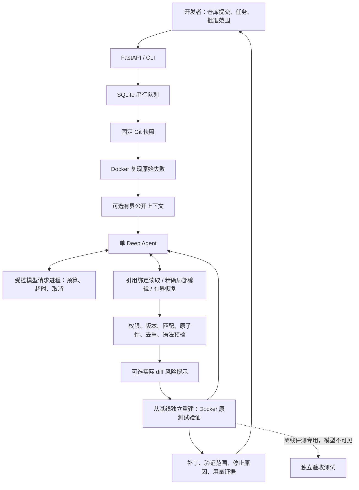

# 工程展示与证据边界

## 架构

应用决定权限、版本、执行和判定；模型提出修改。请求进程负责本地网络生命周期，不是第二个 Agent。普通产品没有独立评测答案，原测试通过不等于全部业务正确。

## 两个真实模型案例

来源：[成对评测摘要](evaluation-simple-edit-20261012.md)及其[脱敏 JSON](evaluation-simple-edit-20261012.json)。均为已经参与分析的模块级回归任务，不是新任务。它们使用旧客户端，不能证明当前严格 30 秒客户端或新上下文配置的效果。

| 案例 | 实际过程 | 结论与限制 |
| --- | --- | --- |
| more-itertools `bucket-falsey-validator` | simple_edit 共 12 次模型调用；第 12 次提交一个局部候选，公开测试和独立验收通过 | 形成有效补丁，但调用预算已耗尽；最大响应 75.294 秒，当前 30 秒客户端可能有不同表现 |
| boltons `bits-empty-conversion` | simple_edit 共 6 次调用；第 5 次提交一个候选，公开测试通过 | 独立验收失败，遗漏反向空值转换；公开通过不足以证明需求覆盖 |

四次成对运行共 42/48 次调用，输入 266,642、输出 10,583 token；两题的 v2 对照均无候选。只能提供混合的小样本证据，不把两题合成泛化改善，不把估计 token 费用写成供应商账单。

## 可据实用于简历的三条描述

- 基于 Deep Agents、FastAPI、SQLite 和 Docker 开发本机 Python 修复工作台，实现固定提交快照、批准文件范围、候选验证、补丁审核与下载，保留完整执行证据。
- 将文件版本与修改位置绑定移到应用侧，实现 source_ref 精确局部编辑、原子提交、语法预检及重复候选检测；修复混合工具错误漏计，按工具类别统计拒绝，在共享调用预算内最多恢复两轮。
- 为 2 个开源项目构建 8 个固定历史 Bug 的模块级任务集，区分公开验证与模型不可见的独立验收；完成多轮真实 qwen-plus 评测，保留成功、漏修及无候选结果，未宣称普遍修复能力。

当前新增上下文与风险审查仅离线验收，不能写成真实成功率提升；CI 已准备但未在远端执行。交付默认保守固定 v2，未获得四配置比较结果；新增仓库级和模块级任务仅资格核验通过，Agent 验证尚待单独批准，相关成绩不提前填写。

## 三个可深入讲述的工程案例

1. **模型有思路却难以提交补丁。** v3 的强制表单与元数据要求增加结构化失败；简化为引用和精确替换，把确定性校验留给应用。两题成对记录验证可执行候选形成，但仍有语义漏修，未据此更换默认。
2. **超时参数与真实请求生命周期不一致。** SDK 请求构造证明 `timeout=30` 没有进入传输参数；改用 `request_timeout` 并管理专用请求进程。慢进程、SIGTERM 抵抗、套接字 EOF、截止、取消与清理失败测试验证本地回收；不能承诺远端推理取消或退款。
3. **公开通过与语义正确分离。** Bits 空转换候选通过公开测试却漏修独立边界。验证从原基线重建并检查测试身份、防止改测试自证成功；非阻断 diff 风险用于审核而非替代执行或独立验收。

新配置真实对照通过前，项目应定位为有限范围、供人工审核的修复工作台。当前明确瓶颈是语义覆盖、长响应与预算，以及静态上下文对动态调用的定位局限。
